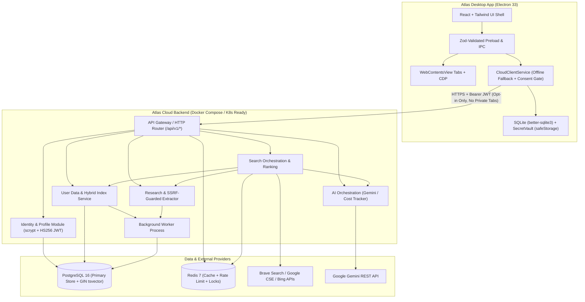

# Atlas Cloud Architecture, Scaling & Kubernetes Roadmap

> **"Browse normally. Delegate intelligently. Stay in control."**

Atlas Browser follows a **staged local-first + modular cloud architecture**. The Electron desktop browser remains fully functional offline (`local_only` mode) and connects optionally to Atlas Cloud (`cloud_connected` mode) with explicit per-category consent.

---

## 1. System Architecture Diagram



---

## 2. Responsibility Split: Desktop vs. Cloud

### Remains Local in Desktop Application
- `WebContentsView` tab lifecycle, Chromium rendering, CDP DOM/AX perception, Set-of-Marks screenshots.
- Private browsing windows/tabs (`PrivateSessionManager`), download safety, ad & tracker blocking.
- Sensitive confirmation modals, Emergency Kill Switch (`Cmd/Ctrl+Shift+Esc`), localhost MCP server.
- Local SQLite bookmarks, browsing history, skills, and encrypted `SecretVault` keys.

### Optional Cloud Backend Modules (`src/backend/`)
| Module | Directory | Responsibility |
| :--- | :--- | :--- |
| **API Gateway** | `src/backend/api/` | Versioned `/api/v1/*` routes, Bearer JWT auth, Zod validation, `X-Request-Id`, CORS, Prometheus `/metrics`. |
| **Identity & Profile** | `src/backend/modules/identity/` | Account registration, login, `scrypt` hashing, JWT access tokens + rotating SHA-256 refresh tokens, device tracking, consent controls, GDPR export/delete. |
| **Search Orchestration** | `src/backend/modules/search/` | `SearchProvider` abstraction, deterministic/LLM query understanding, parallel retrieval, canonical URL dedup, hybrid ranking, optional reranking, verified AI citations. |
| **AI Orchestration** | `src/backend/modules/ai/` | Model tier routing (`fast`/`balanced`/`deep`), Ajv JSON schema validation, cost/token accounting, strict **no silent mock fallback in production**. |
| **Research & Extraction** | `src/backend/modules/research/` | SSRF-hardened fetcher + `@mozilla/readability` extraction + chunking + metadata normalization. |
| **User Data & Hybrid Index** | `src/backend/modules/userdata/`, `knowledge/` | Consent-gated sync of bookmarks, notes, research, approved memory, and PostgreSQL GIN `tsvector` + 64-dim vector hybrid indexing. |
| **Background Worker** | `src/backend/modules/worker/` | Independent worker loop polling `background_jobs` (`FOR UPDATE SKIP LOCKED`) with exponential backoff and `dead_letter` handling. |

---

## 3. PostgreSQL & Redis Architecture

- **Primary Store (`PostgreSQL 16`)**: Migrated cleanly via `src/backend/db/migrations/001_cloud_initial.sql` (transactional `schema_migrations`). Stores `users`, `profiles`, `devices`, `refresh_tokens`, `user_settings`, `search_history`, `bookmarks`, `notes`, `research_reports`, `saved_sources`, `memory_items`, `hybrid_index_documents` (generated `tsvector` with `GIN` index), `task_records`, `background_jobs`, and `audit_events`.
- **Ephemeral Layer (`Redis 7`)**: Used strictly for search response TTL caching (`SearchCache`) and sliding-window API rate limiting (`RateLimiter`), with seamless in-memory fallback when Redis is absent. Redis is never used as a durable system of record.

---

## 4. Docker Local Development & Production Compose

```bash
# 1. Copy environment template
cp .env.example .env

# 2. Build backend & worker containers with PostgreSQL 16 + Redis 7
docker compose up --build

# 3. Verify health & metrics
curl http://127.0.0.1:48080/health
curl http://127.0.0.1:48080/metrics
```

- **Containers**: `Dockerfile.backend` and `Dockerfile.worker` use pinned multi-stage `node:20.19.0-alpine` images running as non-root `atlas` user with `ELECTRON_SKIP_BINARY_DOWNLOAD=1` and HTTP healthchecks.
- **Database Isolation**: `postgres` and `redis` ports are internal to `atlas_internal` bridge network and are not bound to host interfaces.
- **Production Override**: Use `docker compose -f docker-compose.yml -f docker-compose.prod.yml up -d` where `NODE_ENV=production`, `ATLAS_JWT_SECRET` is mandatory, and mock fallbacks are disabled.

---

## 5. Microservice Extraction & Kubernetes Roadmap (`deploy/k8s/`)

Currently, all 7 backend modules run in two containers (`atlas-backend` API and `atlas-worker`). Extract modules into independent deployments ONLY when telemetry shows:
1. **Research & Extraction Service** -> Separate egress-filtered VPC subnet/NodePool for untrusted page fetching isolation and CPU-heavy HTML parsing.
2. **Search Orchestrator & Cache Tier** -> Dedicated HPA scaling pool when search QPS diverges from CRUD sync load.
3. **AI Gateway Service** -> Separate token-quota/cost accounting service if multi-provider billing requires central circuit breaking.

Starter production manifests live in `deploy/k8s/` (`namespace.yaml`, `backend-deployment.yaml` with HPA + PDB + liveness/readiness probes, `worker-deployment.yaml`, `ingress.yaml` with TLS).

---

## 6. Growth, Cost & Scaling Plan (Honest Engineering Roadmap)

| Stage | Target Scale | Infrastructure Triggered | Estimated Monthly Assumptions |
| :--- | :--- | :--- | :--- |
| **Prototype (Current)** | 1–50 users | Single Docker Compose host, `InMemory`/`postgres:16`, optional Redis, desktop local fallback. | \$0–\$20 infra + metered Gemini/Search API calls. |
| **First 1,000 users** | ~5 RPS peak | Managed PostgreSQL (1 primary, PgBouncer pooling), 2 stateless `atlas-backend` replicas behind TLS ingress, 1 worker, Redis cache (TTL 180s). | ~\$60–\$150 infra; cache reduces external search API spend by ~30–40%. |
| **10,000 users** | ~40 RPS peak | Read replica for PostgreSQL `tsvector`/user data reads, dedicated worker HPA (2–4 pods), egress-isolated extraction workers, CDN for static assets. | ~\$300–\$700 infra + usage-based search/AI routing (Flash-first query routing). |
| **100,000 users** | ~300 RPS peak | Dedicated search/vector index tier (OpenSearch or Qdrant/pgvector read cluster), Redis cluster, partitioned `search_history`/`audit_events` tables by month. | Requires measured load benchmarks before provisioning shard topology. |
| **1,000,000+ users** | ~3,000+ RPS | Regional active-active API clusters + GeoDNS, asynchronous Kafka/PubSub worker queues, per-tenant shard routing by `user_id` hash, first-party web index offload for hot queries. | Requires multi-region chaos testing & p99 SLA validation. |
| **Global / Billion-User Ambition** | Architectural pattern | Completely stateless edge auth verification, regional cell architecture (user data pinned to home cell), dedicated first-party inverted + vector web index, strict tiered cost routing. | **Not claimed today** — achievable only after staged benchmark validation at each tier above. |
